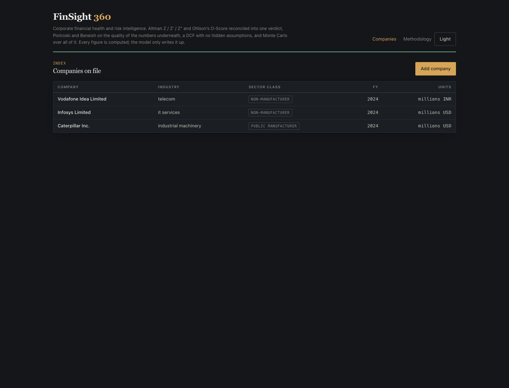
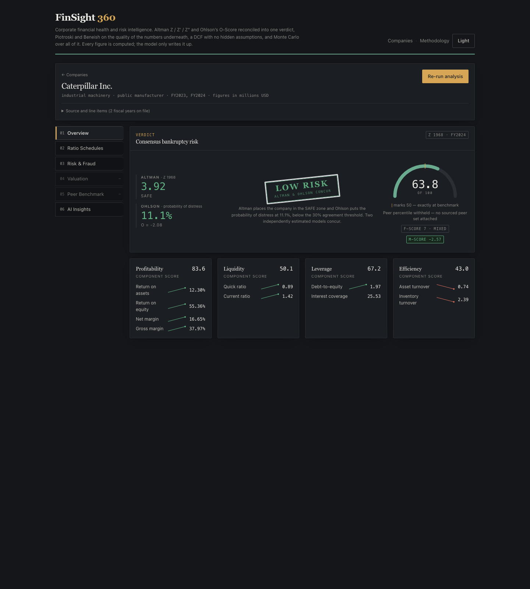

# AutoDeployX

[](https://github.com/IshaanS0112/AutoDeployX/actions/workflows/ci.yml)
[](terraform/)
[](docs/architecture.md)
[](docs/adr/README.md)
[](LICENSE)

**A CI/CD pipeline that deploys containerised services to AWS ECS Fargate and rolls them back automatically when a deploy is bad.**

A `git push` goes through build, scan, sign, migrate and deploy. If the new version fails its health check, the previous version keeps serving and traffic never moves. Everything is Terraform, and no long-lived AWS key exists anywhere in the repository.


---

## What a bad deploy looks like

The deployment circuit breaker is the feature this project is built around. The new revision starts beside the old one, fails three health checks, and is rolled back. The public URL answers the whole time.



The pipeline does not use `aws ecs wait services-stable`, because that command reports a rolled-back service as a success. It polls `rolloutState` instead, which separates `COMPLETED` from `FAILED`.

---

## How it is built

| Concern | What the repository does | Why |
|---|---|---|
| **Credentials** | GitHub OIDC to AWS, short-lived STS tokens | No stored key to leak or rotate |
| **Permissions** | Pull requests and the drift check use a read-only role. Apply uses a separate role behind a protected environment | A plan reads; it should never be able to deploy |
| **Images** | Tagged with the git SHA, never `latest`. Built for ARM64, scanned by Trivy, signed with keyless `cosign` | You can say exactly which commit is running, and verify it |
| **Migrations** | A one-off ECS task from the same image, run before the rollout | A container in the service task would run once per task, so several times during a rolling deploy |
| **Database connections** | `make lint` fails if the pool size, multiplied by the task count and the 200% rollout peak, exceeds what `db.t3.micro` allows | Exhausting connections does not fail a deploy. It fails the first request after it |
| **Health** | `/health/live` decides restarts and never touches the database. `/health` decides traffic and checks Postgres | Restarting a container does not fix a database outage |
| **Shutdown** | Timeouts are ordered: nginx read, then container stop, inside the load balancer's drain window | Otherwise a green deploy drops connections |
| **Cost** | Every expensive option is a variable that defaults to off. `make cost` prices a configuration before you apply it | The default stack is about $0.03 an hour |

The reasoning for each decision is in [`docs/adr/`](docs/adr/README.md). Each record names the alternative that was rejected and what it cost.

---

## Cost


Of the $48 a month, the AWS free tier covers the RDS instance and its storage for twelve months, which is about $15. The remaining $33 is the load balancer and Fargate, which the free tier does not cover. The chart is an estimate from [`scripts/cost-estimate.sh`](scripts/cost-estimate.sh). It excludes data transfer and per-request charges, which scale with traffic.

---

## The application it deploys

The pipeline deploys two services. This screenshot is FinSight 360, running from the images this pipeline builds.

| Dashboard | Company detail |
|---|---|
|  |  |

The health endpoint reports the commit it is running. Example output:

```json
{ "status": "healthy", "checks": { "database": "ok" }, "commit": "a3f9c21b", "service": "finsight" }
```

That `commit` field is what the pipeline's smoke test checks after every deploy.

---

## Status

**Run and verified locally:** the images build; the stack serves traffic in Docker; health reports the deployed commit; SPA deep links return 200; security headers are present on API responses; correlation IDs pass through to the logs; rate limiting sheds load; image sizes are measured (API 342 to 309 MB on disk, 71 to 63 MB compressed).

**Run and verified on AWS:** both services, FinSight 360 and StrategySphere, deployed to ECS Fargate through the pipeline, several times. The smoke test (G6) passed against the live URL. The rollback drill (G7) passed: a deliberately broken revision failed its health checks, the circuit breaker restored the previous revision, and the public URL kept answering throughout.

**Validated, but never applied to a real AWS account:** TLS and host routing, private subnets with NAT or VPC endpoints, WAF, multi-AZ RDS, autoscaling, and the migration stage. They pass `terraform validate` and the policy checks.

---

## Repository layout

```
services/services.json     one manifest, read by both the pipeline and Terraform
docker/                    Dockerfiles, nginx config, compose file for local runs
terraform/                 root module, nine child modules, and envs/ (tfvars templates)
.github/workflows/         deploy, rollback, CI, terraform plan, drift detection
scripts/                   deploy, migrate, smoke test, teardown, cost estimate, and more
policy/                    rules about this project, checked with conftest; 21 fixtures
patches/                   changes needed in the two deployed repositories, as diffs
load/                      k6 load profiles: ramp, stress, soak
docs/                      ADRs, setup, runbook, backend operations, cost, diagrams
Makefile                   make help lists every target
```

---

## Quick start

These need no AWS account:

```bash
make help                  # every target
make check                 # lint, Terraform validation, manifest schema
make policy                # policy rules, plus checkov
make cost                  # price the stack described by the tfvars
make up SERVICE=finsight   # run a service locally in Docker, on localhost:8080
```

To deploy to AWS, follow [`docs/setup.md`](docs/setup.md). It starts with the budget alarms, which are applied before anything billable exists.

---

## Limitations

- **Port-based routing by default** (`:80` and `:8080`). Host routing and TLS are built and turn on when a domain is set.
- **One task per service by default.** Autoscaling is built and off.
- **One of the two services still creates its schema at startup** and has migrations disabled. The pipeline prints a warning on every deploy until that changes.
- **Migrate-then-deploy** means new schema meets old code for the length of a rollout. A destructive change needs three deploys: expand, migrate, contract.
- **Connection sizing is derived, not measured.** The soak load profile exists to test it.
- **The NAT instance option is a single point of failure.** It is cheap, and the documentation says so.

The full list is in [`docs/architecture.md`](docs/architecture.md).

---

## Related

- [FinSight 360](https://github.com/IshaanS0112/FinSight-360) and [StrategySphere AI](https://github.com/IshaanS0112/StrategySphere-AI), the two services this pipeline deploys
- [OpsForge Nexus](https://github.com/IshaanS0112/OpsForge-Nexus), which covers anomaly detection and root-cause analysis

---

## License

MIT. See [LICENSE](LICENSE).
